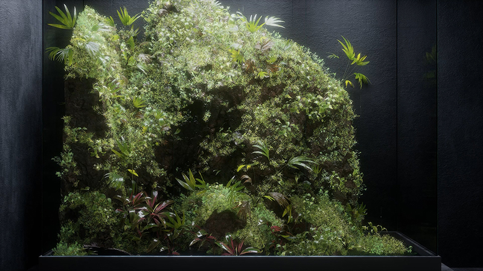
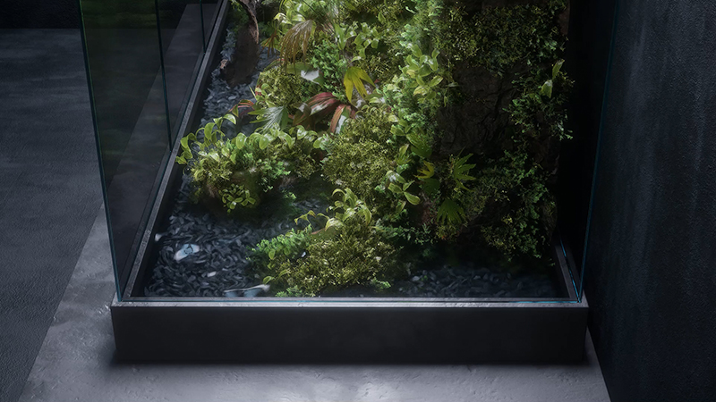
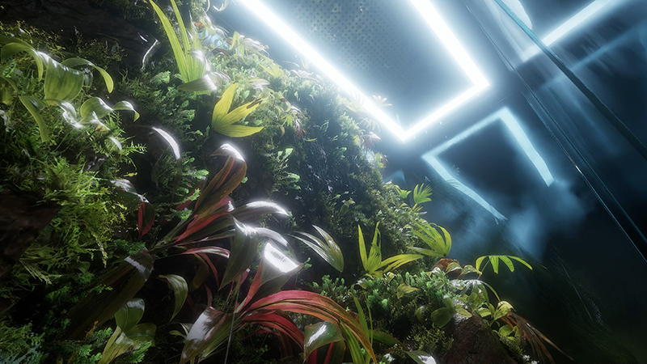
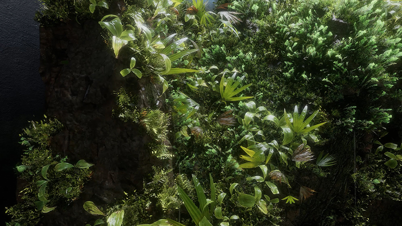
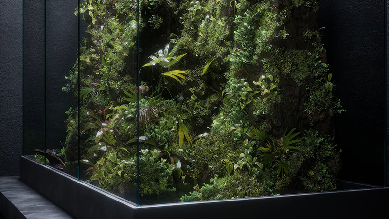
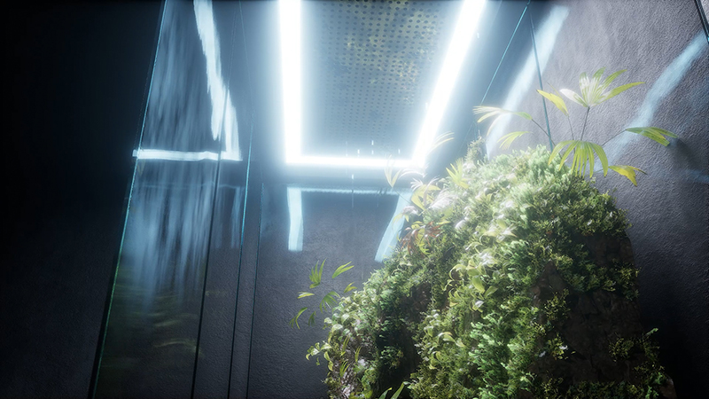
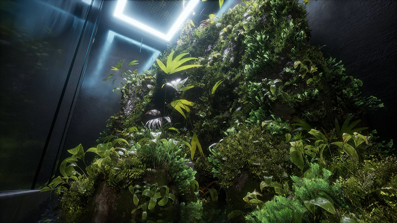
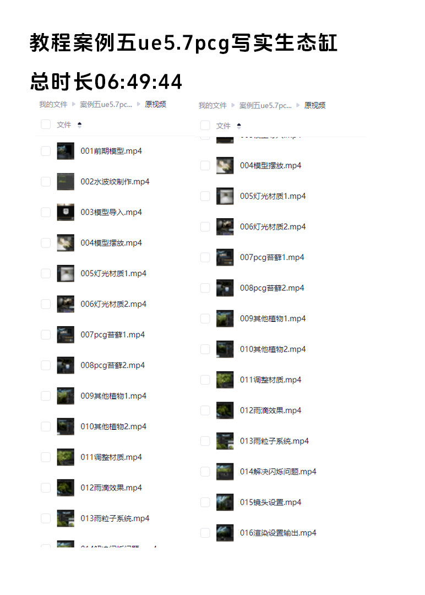

## 🎨 图片预览

  
  
  
  
  
  
  
  

## 🎬 视频预览

#### [哔哩哔哩视频](https://www.bilibili.com/video/BV1WAXwBCEGR?spm_id_from=333.788.videopod.sections&vd_source=ca39cac5719ef82da8ad1505d6417aeb)

## 📖 教程说明

本课程为 **虚幻引擎 UE5.7 PCG生态缸** 零基础入门教程。教学内容：

1. UE5.7 PCG写实场景制作
2. 沿用教程案例四中的植物资产
3. PCG 与蓝图的联动
4. PCG 节点类型说明
5. Niagara 粒子
6. MRQ 渲染设置方法
7. 渲染问题的解决

 💡 **学习目标**：帮助学员从正确路径起步，开启自己的场景交互项目，快速高效地完成场景制作，熟练运用 PCG 程序化生成功能。

---

## 🏆 教程优势

- 一对一辅导，永久答疑
- 支持远程协助，随时提供帮助
- 教程从零基础讲起，新手也能轻松上手
- 课程目录与时长公开透明，拒绝注水（课程目录时长见文末）
- 可为工作项目或个人作品提供针对性帮助
- 主页发布的所有作品均可免费分享学习
- 课程随 UE 版本持续更新，内容常学常新

---

## 🎯 适合人群

如果你打算成为以下从业者，本课程将非常适合你：

1. 计划进入虚幻引擎相关行业
2. 希望从事室内交互、建筑交互、建筑沙盘、游戏场景等 UE 交互方向的工作者
3. 希望几分钟内完成作品或工作项目的渲染，告别漫长等待
4. 深耕**漫游交互**行业，不满足于商业效果图的从业者
5. 从事效果图表现行业，希望**进一步提升自己**的从业者
6. 想突破单张效果图瓶颈，制作**高质量漫游**内容的制作人员

---

## 🎁 学习收获

通过本套教程的学习，你将获得：

- 快速熟悉虚幻引擎的使用方法
- 熟练运用虚幻引擎到实际工作中
- 制作出**高质量、以假乱真**的场景
- 掌握快速出图或动画的能力
- 熟练制作属于自己的交互场景

## 📝 课程目录

#### 课程总时长: 6小时49分

