## 🎨 图片预览

  
  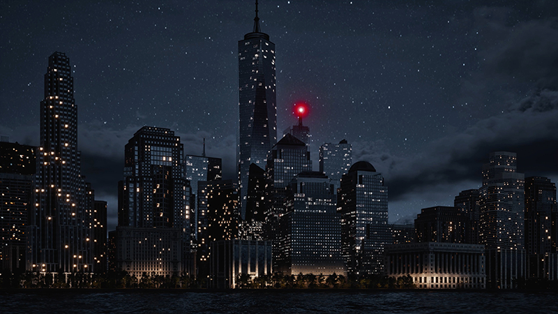
  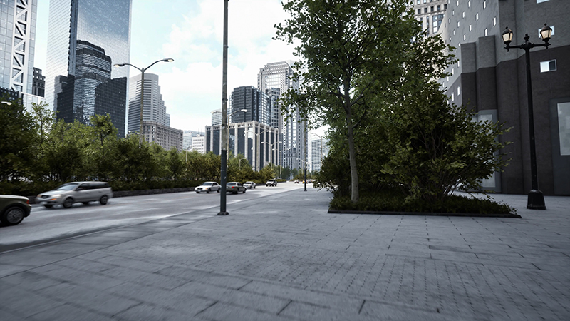
  
  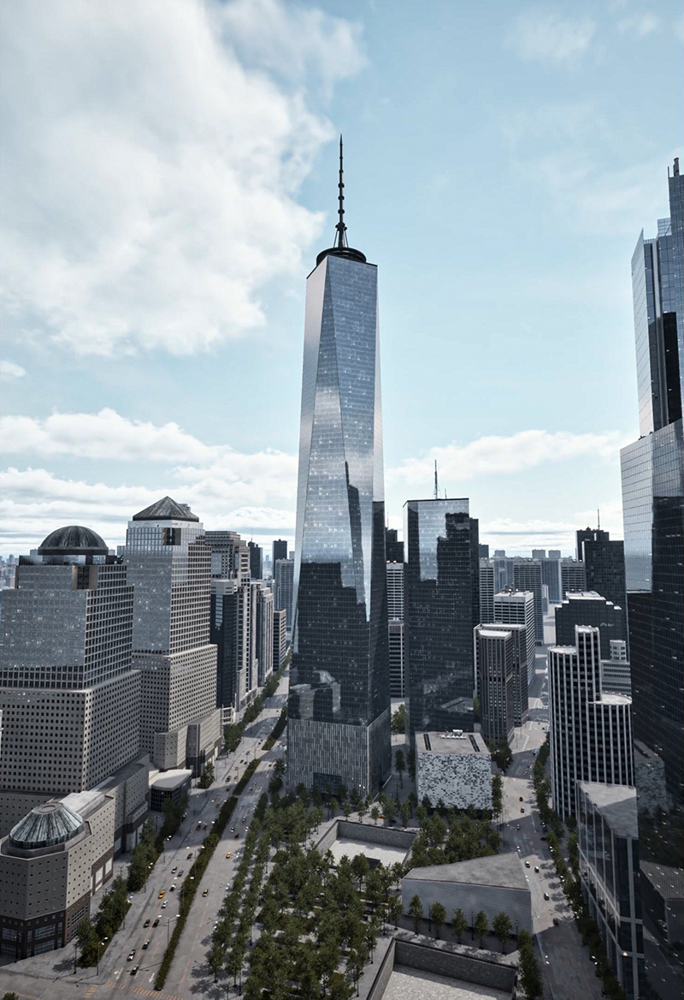
  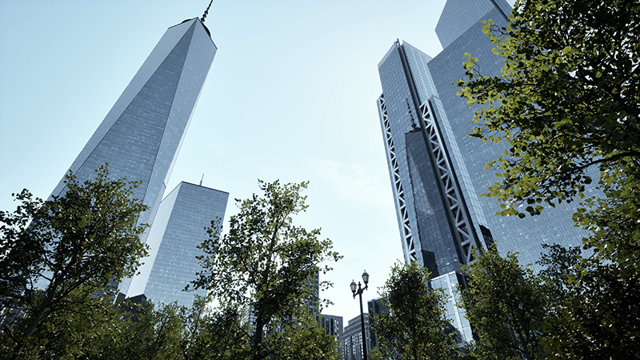
  
  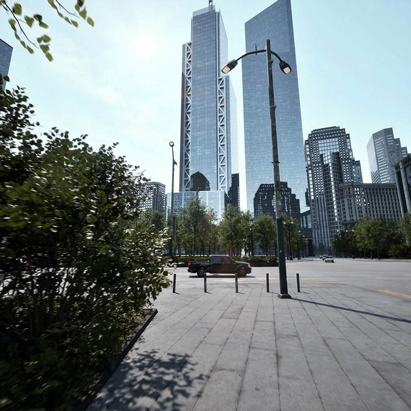
  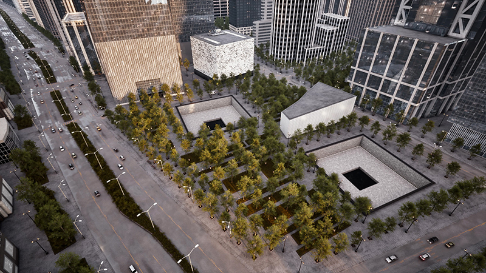
  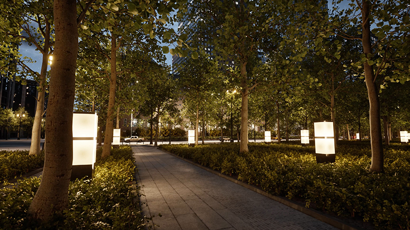
  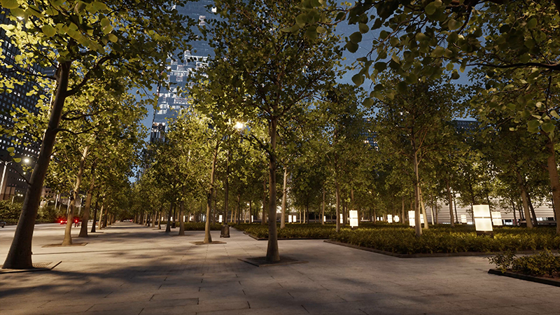
  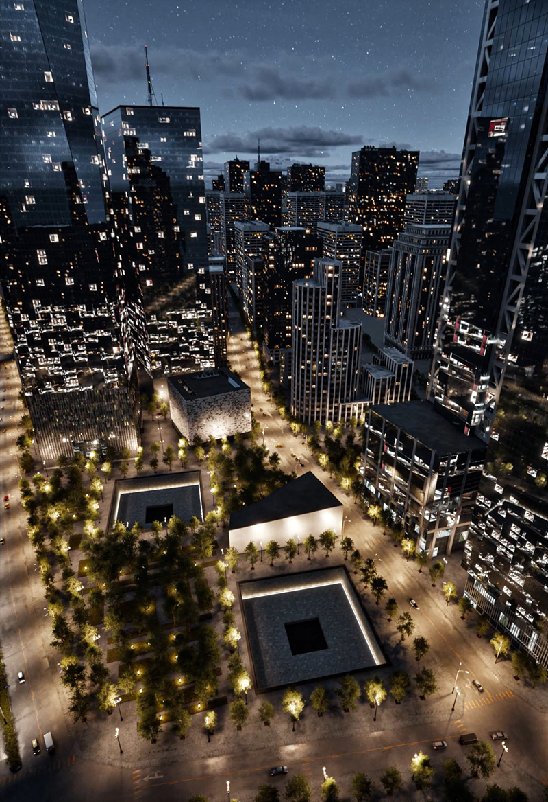
  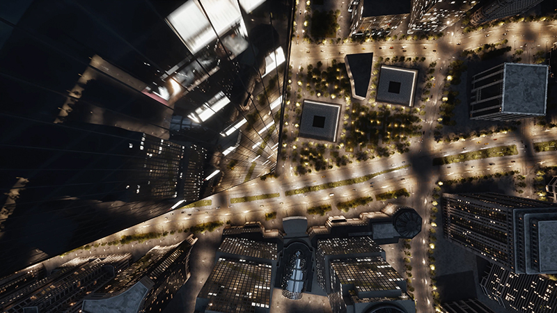
  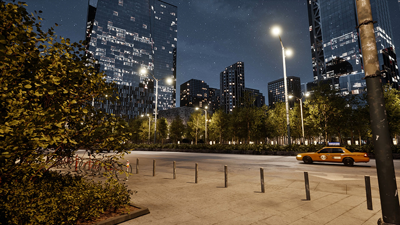
  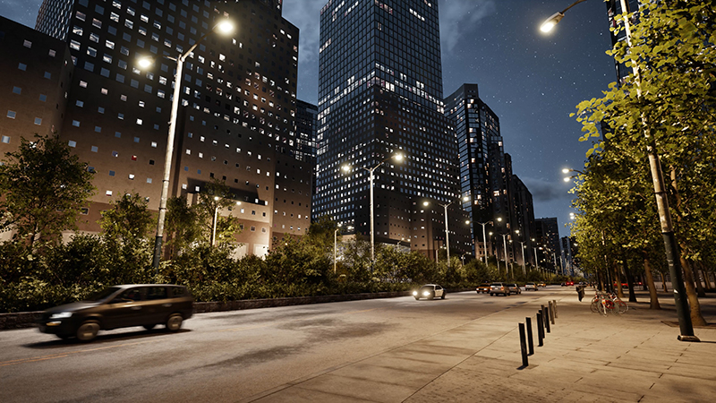
  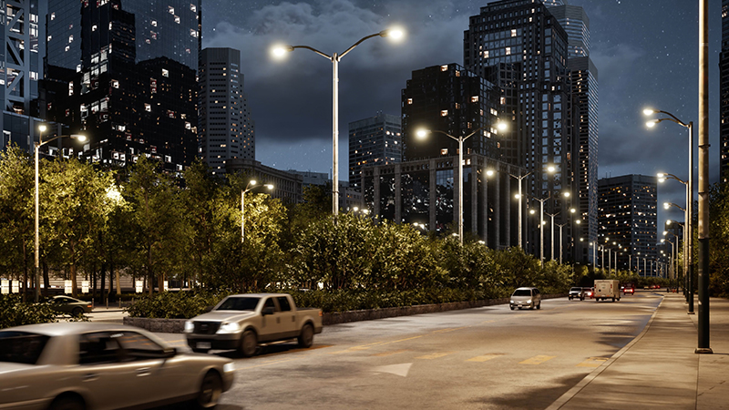

## 🎬 视频预览

#### [哔哩哔哩视频](https://www.bilibili.com/video/BV1V3d5BqEC1/?spm_id_from=333.1387.collection.video_card.click&vd_source=ca39cac5719ef82da8ad1505d6417aeb)

## 📖 教程说明

本课程为 **虚幻引擎 UE5.7 纽约世界贸易中心城市** 零基础入门教程。教学内容：

1. UE5.7 大型城市场景完整制作流程
2. 三大城市建模方法：透视建模法、CityEngine、谷歌地图模型提取
3. UltraDynamicSky 超强天气插件中文版使用方法
4. 公路程序化复杂材质
5. 建筑玻璃视差贴图
6. 程序化建筑玻璃夜晚随机发光材质
7. 两套 UV 模型导入方法
8. 白天夜晚路灯与窗户灯自动开关
9. 适合室外的蓝图交互与 UI 面板
10. 过场动画切换蓝图功能
11. 天气切换蓝图功能
12. PVE 程序化植被风动效果
13. FluidFlux 海洋波浪
14. DLSS
15. MassAI
16. IK 绑定
17. UE 打包报错分析
18. LUT 制作
19. PCG 植被、PCG 街道、PCG 路灯、PCG 远景城市、PCG 建筑……
20. **内容体量庞大，是课程时长与项目文件最大的一个教程**

 💡 **学习目标**：帮助学员从正确路径起步，开启自己的场景交互项目，快速高效地完成场景制作，实现实时交互、单张渲染与漫游动画制作，并了解城市与城市沙盘的完整制作过程。

---

## 🏆 教程优势

- 一对一辅导，永久答疑
- 支持远程协助，随时提供帮助
- 教程从零基础讲起，新手也能轻松上手
- 课程目录与时长公开透明，拒绝注水（课程目录时长见文末）
- 可为工作项目或个人作品提供针对性帮助
- 主页发布的所有作品均可免费分享学习
- 课程随 UE 版本持续更新，内容常学常新

---

## 🎯 适合人群

如果你打算成为以下从业者，本课程将非常适合你：

1. 计划进入虚幻引擎相关行业
2. 希望从事室内交互、建筑交互、建筑沙盘、游戏场景等 UE 交互方向的工作者
3. 希望几分钟内完成作品或工作项目的渲染，告别漫长等待
4. 深耕**漫游交互**行业，不满足于商业效果图的从业者
5. 从事效果图表现行业，希望**进一步提升自己**的从业者
6. 想突破单张效果图瓶颈，制作**高质量漫游**内容的制作人员

---

## 🎁 学习收获

通过本套教程的学习，你将获得：

- 快速熟悉虚幻引擎的使用方法
- 熟练运用虚幻引擎到实际工作中
- 制作出**高质量、以假乱真**的场景
- 掌握快速出图或动画的能力
- 熟练制作属于自己的交互场景

## 📝 课程目录

#### 课程总时长: 41小时28分
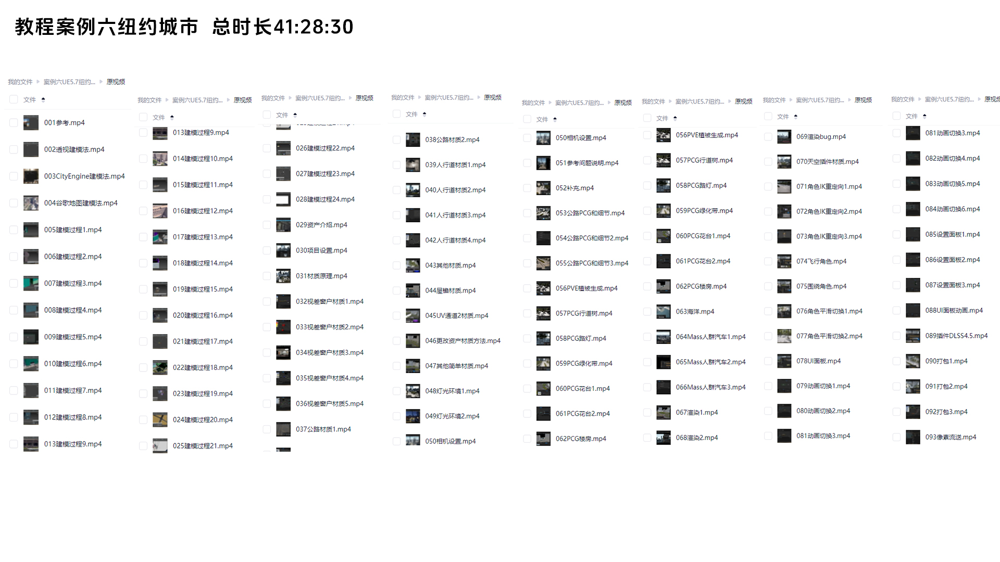
