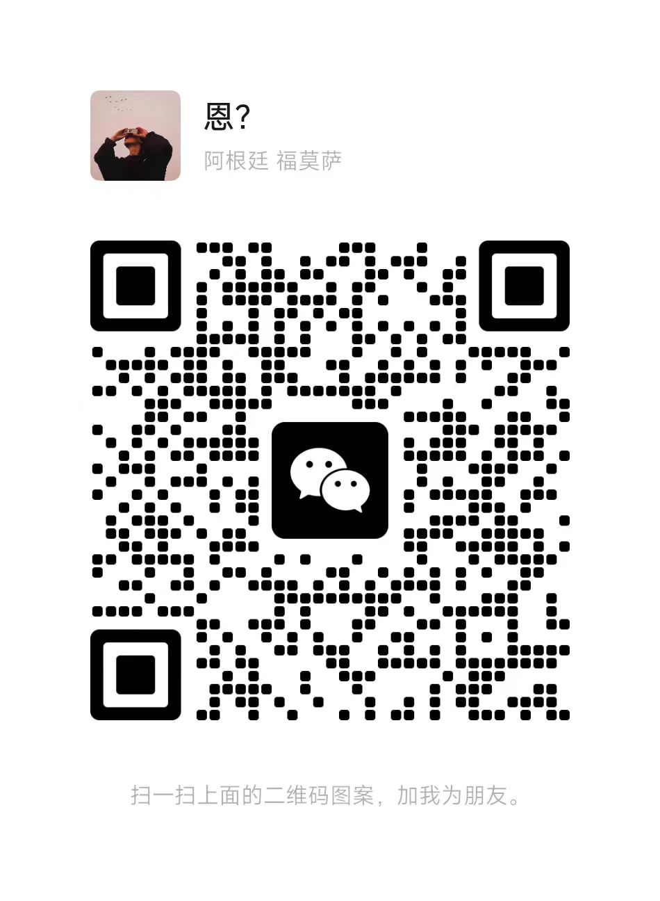


<!-- 左右分栏大容器 -->

  <!-- 左边：你的文字信息 -->
  

    
    <h2 style="font-size: 50px; margin-top: 0; margin-bottom: 10px; color: #fff; text-align: left;">欢迎联系我</h2>
    
    

      
如果你对我的课程感兴趣，或者有任何疑问，欢迎通过以下方式联系我：

    

    

      
      

        <strong style="font-size: 20px; color: #999;">微信号：</strong>
        ue577777
      

      

        <strong style="font-size: 20px; color: #999;">Q群号：</strong>
        966268287
      

      <!-- 淘宝链接 -->
      

        <strong style="font-size: 20px; color: #999;">淘宝店铺：</strong>
        <a href="https://e.tb.cn/h.8swCi0KSe9l29NF?tk=wf9dTjCYorx" target="_blank" style="font-size: 20px; color: #fb7299; text-decoration: underline; font-weight: bold;">
          点击进入我的淘宝店
        </a>
      

      
    

  

  <!-- 二维码图片 -->
  

    <!-- 👇 这里改成了带 /my/ 的绝对路径 👇 -->
    
    
扫码添加我的微信

  

